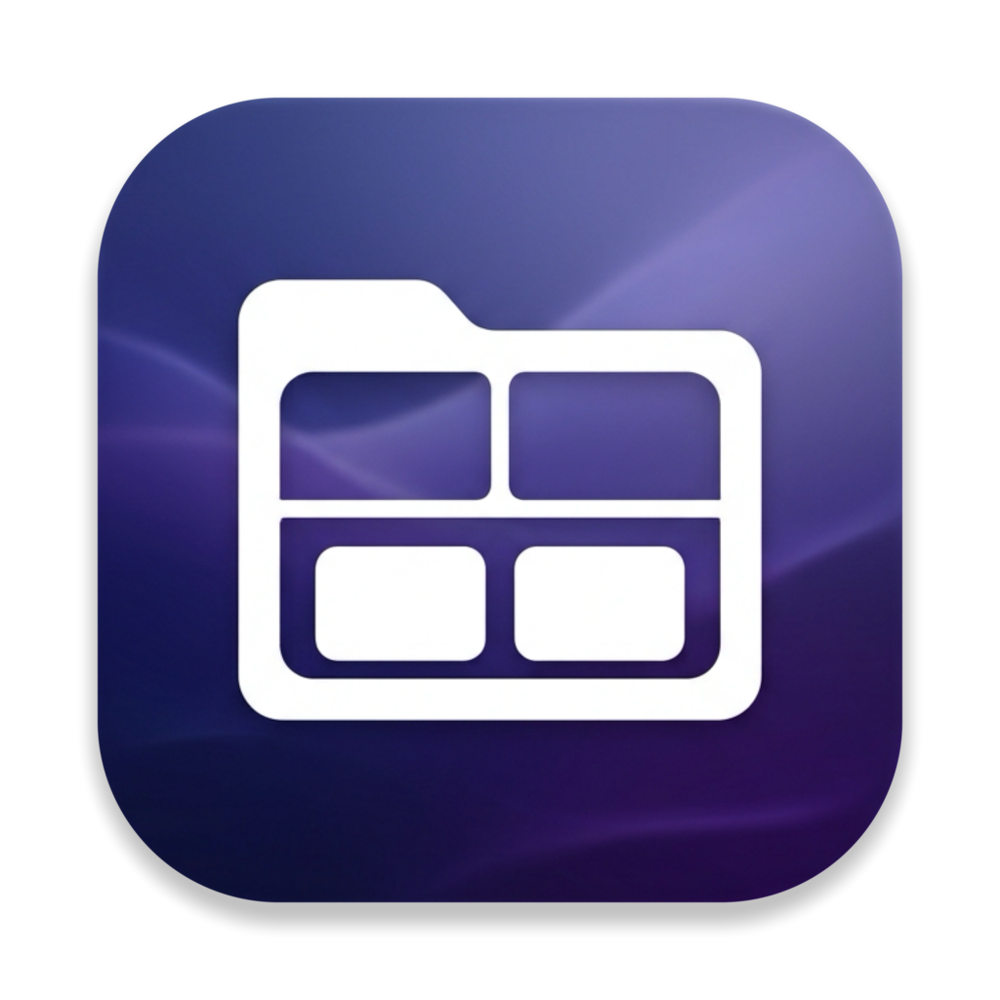
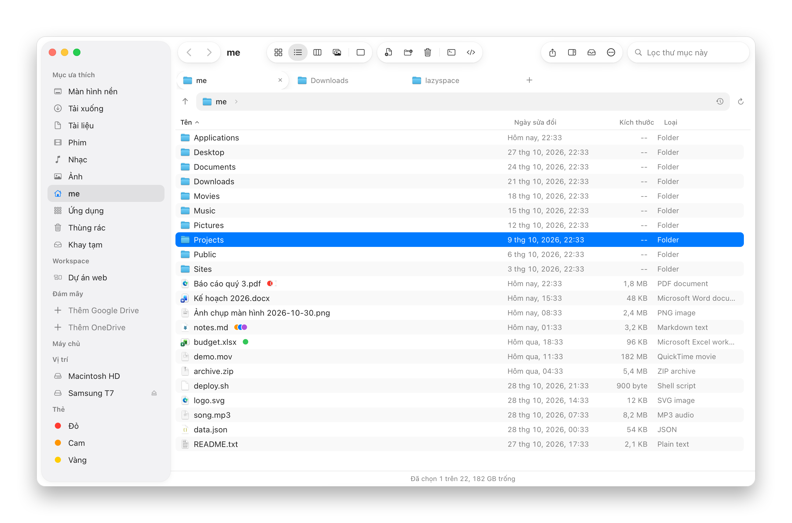
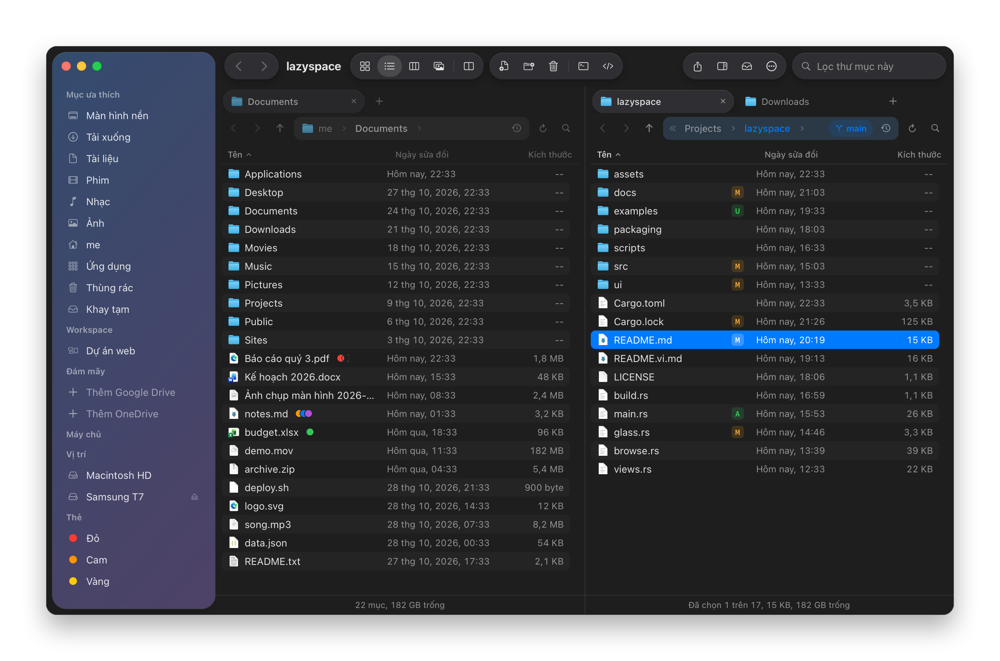
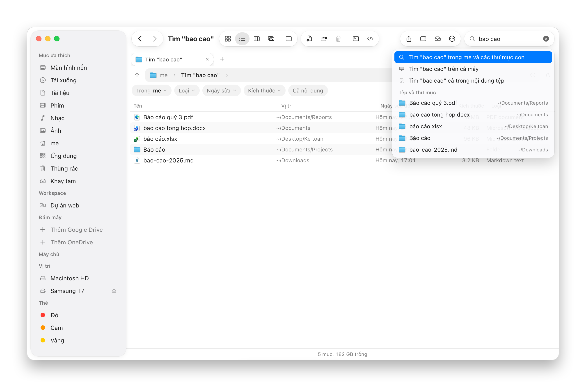
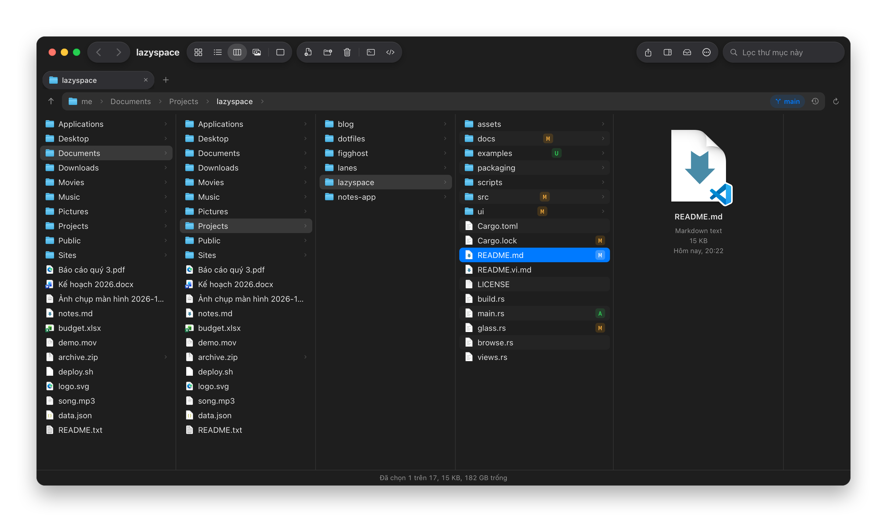
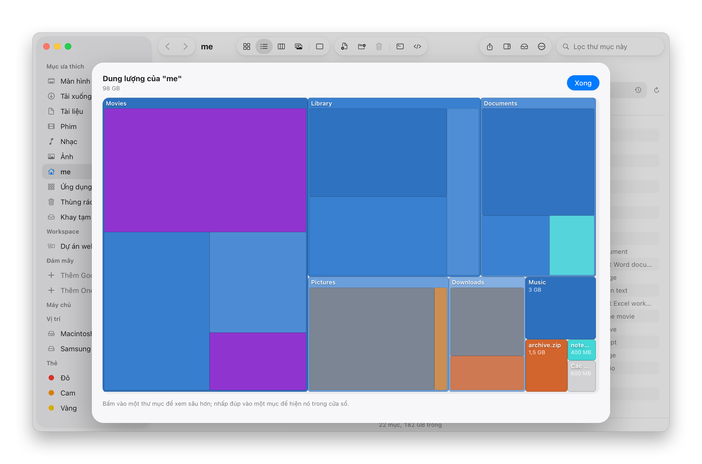

  

<h1 align="center">LazySpace</h1>

  Trình quản lý tệp cho macOS với tối đa bốn khung, workspace, tệp nén, máy chủ và khay tạm. 
  Giao diện và phím tắt như Finder, nhanh như một trình quản lý hai khung, trong cửa sổ Liquid&nbsp;Glass.

  
  

  
  
  

LazySpace là trình quản lý tệp viết bằng Rust. Cửa sổ là một trang web đặt trên các thành phần gốc của macOS: biểu
tượng và ảnh thu nhỏ của hệ thống, Xem nhanh, Thùng rác, kéo thả với ứng dụng khác, menu chuột phải thật, Keychain.
Mọi thư mục được liệt kê và sắp xếp trong Rust, nên thư mục một trăm nghìn tệp vẫn mở trong chưa tới một giây; mọi
thao tác tệp chạy thành một tác vụ có tiến độ, có thể hủy và hoàn tác. Ứng dụng có tiếng Việt và tiếng Anh.

  

## Tính năng

- **Tối đa bốn khung, có tab như File Explorer.** Sáu bố cục: một khung, hai khung cạnh nhau hoặc trên dưới, ba khung,
  một trái hai phải, hoặc lưới bốn khung. Mỗi khung có tab, lịch sử và kiểu xem riêng (danh sách hoặc biểu tượng).
  Thanh tab hiện cả khi chỉ có một tab, kèm nút tab mới; kéo tab để đổi chỗ hoặc sang khung khác, bấm chuột giữa để
  đóng, chuột phải có menu riêng (nhân bản, chuyển sang cửa sổ mới hoặc khung bên kia, đóng các tab khác hoặc bên
  phải). Chuột giữa hoặc Command và nhấp đúp mở thư mục trong tab mới. Khung hẹp thì bớt cột, như QSpace.
- **Workspace.** Bố cục, các khung, các tab và vị trí của cửa sổ được lưu theo tên ở thanh bên, bấm là trở lại
  (Command-Option-W để lưu).
- **Thanh đường dẫn như File Explorer.** Bấm vào từng phần, mũi tên sau mỗi phần liệt kê thư mục con của nó, bên cạnh
  có nút lên thư mục cha và tải lại, cuối thanh là những nơi đã đến. Khi gõ, thanh gợi ý những nơi đó trước rồi tới
  các thư mục khớp đường dẫn; `~` là thư mục nhà, và gõ được cả `sftp://`, `s3://` cùng các nơi khác. Chuột phải vào
  nút lùi, tiến để thấy danh sách nơi sẽ tới.
- **Tìm nhanh như gõ.** Chỉ mục nhanh của thư mục nhà và Ứng dụng, giữ trong bộ nhớ và tự cập nhật theo FSEvents, so
  khớp như fzf (cùng cách chấm điểm, viết bằng Rust; gõ không dấu vẫn ra, "bao cao" tìm được "Báo cáo"). Các mục khớp
  nhất hiện ngay dưới ô tìm khi gõ; Enter tìm thư mục đang mở và mọi thư mục con, khớp nhất lên đầu, có lọc theo loại,
  ngày, kích thước và nội dung (Spotlight), hoặc tìm cả máy.
- **Bốn dạng xem như Finder.** Biểu tượng, danh sách, cột (Miller) và gallery (Command-1 đến 4). Danh sách có các cột
  tự chọn (ngày sửa, ngày tạo, kích thước, loại, đuôi, vị trí) bằng chuột phải vào tiêu đề cột, và nhóm theo loại,
  ngày hoặc kích thước.
- **Gần đây và thẻ.** Các tệp dùng gần đây ở đầu thanh bên; thẻ màu của Finder hiện thành chấm, gắn từ menu chuột phải,
  mỗi màu là một mục tìm cả máy trên thanh bên.
- **Kéo khung để chọn** ở vùng trống cạnh các mục, giữ Shift để thêm, Command để đảo.
- **Chia sẻ** qua bảng chia sẻ của hệ thống (AirDrop, Tin nhắn, Mail) từ thanh công cụ hoặc menu chuột phải.
- **Lệnh của riêng bạn** trong menu chuột phải: một dòng zsh chạy với các mục đang chọn làm tham số, hiện kết quả hoặc
  chạy trong Terminal.
- **Cái gì chiếm chỗ.** Bản đồ dung lượng của thư mục kiểu DaisyDisk, và các tệp trùng nhau (theo kích thước rồi theo
  nội dung), chọn sẵn bản thừa để đưa vào Thùng rác.
- **Git trong danh sách.** Tệp đã sửa, mới hoặc xung đột có dấu sau tên, nhánh hiện trên thanh đường dẫn.
- **Chép biết chờ và biết kiểm.** Tạm dừng, chạy tiếp mọi tác vụ; có thể cho các lần chép chạy lần lượt và kiểm tra
  từng byte sau khi chép.
- **Mở trong LazySpace từ Finder.** Menu chuột phải của thư mục hay tệp trong Finder (và mục Dịch vụ của mọi ứng dụng)
  có "Mở trong LazySpace"; thả thư mục lên biểu tượng Dock để mở thành tab.
- **Ghim thư mục.** Ghim bất kỳ thư mục nào vào thanh bên từ menu của nó, bỏ ghim ngay trên thanh bên.
- **Màn hình nền do LazySpace hiện (tùy chọn).** Các mục của thư mục Màn hình nền trên hình nền, dưới mọi cửa sổ và ở
  mọi Space, mỗi biểu tượng nằm đúng chỗ bạn đặt, có menu chuột phải, phím tắt, Xem nhanh và kéo thả như một khung.
  Biểu tượng của Finder có thể ẩn khi bật, và trở lại khi tắt.
- **Tạo tệp mới từ mẫu.** Văn bản, Markdown, tài liệu Word và Excel, script, HTML, JSON, và mọi tệp bạn thêm làm mẫu.
- **Mở trong Terminal hoặc trình soạn thảo.** Terminal, iTerm2, Warp, Ghostty, kitty, WezTerm, Hyper, Tabby; VS Code,
  Cursor, Zed, Sublime Text, Nova, BBEdit, Xcode, hoặc ứng dụng bạn thêm, có trên máy; ứng dụng dùng gần nhất là mặc định.
- **Mã băm.** MD5, SHA-1, SHA-224, SHA-256, SHA-384, SHA-512 và CRC32 trong một lần đọc tệp, so được với giá trị bạn
  dán vào.
- **So sánh và đồng bộ thư mục.** Theo kích thước và ngày hoặc theo nội dung, trái sang phải, phải sang trái hoặc hai
  chiều, xem trước mọi thay đổi và chọn cho từng mục trước khi làm. Mục bị xóa trên máy này đi vào Thùng rác.
- **Khung xem trước.** Ảnh, phim và âm thanh kèm kích thước, tốc độ khung hình và tốc độ dữ liệu, PDF, và tệp văn bản
  nhỏ sửa và lưu tại chỗ, ở bên phải hoặc bên dưới.
- **Phím tắt kiểu Windows.** Một công tắc cho phím của Windows Explorer: Control-C, X, V cho tệp, Enter để mở, F2 đổi
  tên, Delete chuyển vào Thùng rác, Backspace lên thư mục cha.
- **Menu chuột phải theo ý bạn.** Menu gốc của macOS; vị trí, ẩn hiện, biểu tượng và đường phân cách của từng mục chỉnh
  trong Cài đặt.
- **Dung lượng thư mục ngay trong danh sách**, tính ở chế độ nền.
- **Máy chủ.** SFTP (có khóa SSH, ssh-agent và kiểm tra khóa của máy chủ), FTP và FTPS, Amazon S3, Aliyun OSS và dịch
  vụ tương thích S3 như MinIO, cùng ổ chia sẻ SMB, AFP, NFS và WebDAV do macOS gắn. Mật khẩu chỉ nằm trong Keychain.
- **Đám mây.** Mục Đám mây của thanh bên hiện iCloud Drive và thư mục của các app Google Drive, OneDrive, Dropbox, Box
  chính hãng. Không cài các app đó vẫn đăng nhập được Google Drive, OneDrive, Dropbox và các đám mây khác ngay trong
  LazySpace: trình duyệt mở ra để đăng nhập qua [rclone](https://rclone.org), và rclone được cài bằng Homebrew nếu
  chưa có.
- **Tệp nén mở như thư mục.** Zip (cả mật khẩu AES), 7z (cả mật khẩu và tên mã hóa), RAR, tar với gzip, xz hoặc bzip2,
  ISO và nhiều loại khác mở như thư mục chỉ đọc. Giải nén giữ mọi tệp trong thư mục đích. Nén thành zip, 7z hoặc tar,
  có mật khẩu và chia nhỏ khi định dạng cho phép.
- **Khay tạm.** Một giỏ nổi gom tệp, ảnh, liên kết và văn bản từ bất cứ đâu, để kéo ra lại sau (Command-Option-T).
- **Đổi tên hàng loạt.** Thay thế (cả biểu thức chính quy), chèn, xóa, đánh số, tên thư mục cha, chữ hoa thường và
  phần mở rộng; xem trước trực tiếp, kiểm tra trùng tên, và hoàn tác được.
- **Lệnh và phím tắt.** Command-P liệt kê mọi lệnh kèm phím tắt, tìm theo tên tiếng Việt hay tiếng Anh, gõ không dấu
  vẫn được. F5 và F6 chép và chuyển sang khung kia, Command-U đổi chỗ hai khung, Command-Shift-T mở lại tab vừa đóng.
- **Màu sắc của bạn.** Sáng, tối hoặc theo hệ thống, các màu nhấn của Mac, biểu tượng thanh bên xám hoặc có màu, biểu
  tượng từ 48 tới 128 điểm, ba cỡ chữ cho danh sách, và phông chữ của cả cửa sổ: phông hệ thống, SF Pro Rounded, New
  York, SF Mono hoặc bất kỳ phông nào đã cài trên máy. Cài đặt chia trang như System Settings, có ô tìm kiếm.
- **Liquid Glass (beta).** Như Finder trên macOS 26: cửa sổ đặc, thanh bên là tấm kính nhìn thấy hình nền phía sau,
  dùng kính gốc của macOS 26 nếu có. Thanh công cụ tự gập khi cửa sổ hẹp như thanh công cụ gốc, biểu tượng là SF
  Symbols của hệ thống.
- **Hoàn tác.** Chuyển, đổi tên, tạo mới và đưa vào Thùng rác đều hoàn tác được bằng Command-Z.
- **Tiếng Việt hoặc tiếng Anh**, và tự cập nhật trong ứng dụng.

## Ảnh chụp màn hình

<table>
  <tr>
    <td width="50%"></td>
    <td width="50%"></td>
  </tr>
  <tr>
    <td align="center">Hai khung ở chế độ tối với Liquid Glass, trạng thái Git của từng tệp và nhánh hiện tại</td>
    <td align="center">Tìm ngay khi gõ: các mục khớp nhất dưới ô tìm, trang kết quả có bộ lọc</td>
  </tr>
  <tr>
    <td width="50%"></td>
    <td width="50%"></td>
  </tr>
  <tr>
    <td align="center">Dạng cột, xem trước tệp đang chọn</td>
    <td align="center">Thư mục chứa gì, vẽ thành bản đồ dung lượng</td>
  </tr>
</table>

## Bàn phím

Các phím của Mac như trong Finder, cộng thêm những phím dưới đây. Command-/ hiện tất cả ngay trong ứng dụng.

| Phím | Tác dụng |
|---|---|
| Command-P, Command-/ | Lệnh và phím tắt |
| F5, F6 | Chép, chuyển mục đã chọn sang khung kia |
| Command-U | Đổi chỗ hai khung |
| Command-Option-O | Mở thư mục đã chọn ở khung kia |
| Tab, Shift-Tab | Khung sau, khung trước |
| Command-T, Command-W, Command-Shift-T | Tab mới, đóng tab, mở lại tab vừa đóng |
| Control-Tab, Command-Shift-] và [ | Tab sau, tab trước |
| Command-Option-1 tới 6 | Bố cục |
| Command-1, Command-2 | Biểu tượng, danh sách |
| Command-= và Command-- | Biểu tượng to hơn, nhỏ hơn |
| Space | Xem nhanh |
| Command-Shift-P | Khung xem trước |
| Command-R | Tải lại thư mục |
| Command-Option-V | Chuyển mục đã chép tới đây |
| Command-Shift-N, Command-Option-N | Thư mục mới, tệp mới từ mẫu |
| Command-Option-R | Đổi tên hàng loạt |
| Command-Option-K | So sánh và đồng bộ |
| Command-Option-H | Mã băm |
| Command-K | Kết nối máy chủ |
| Command-Option-T | Khay tạm |
| Command-Option-W | Lưu workspace |
| Command-Control-T, Command-Control-E | Mở trong Terminal, trong trình soạn thảo |

## Cài đặt

Máy Mac chip Apple hoặc Intel, macOS 13 trở lên. Với Homebrew:

    brew tap eliasbui/lazyspace
    brew install --cask eliasbui/lazyspace/lazyspace

Không dùng Homebrew:

    curl -fsSL https://raw.githubusercontent.com/eliasbui/lazyspace/main/scripts/install.sh | sh

Ghi đủ tên cask là cài từ tap và chỉ tin đúng cask đó. Ứng dụng ký ad hoc, không notarize, nên cả hai cách đều gỡ cờ
quarantine sau khi cài, như các ứng dụng mã nguồn mở khác. macOS hỏi một lần cho mỗi thư mục được bảo vệ (Màn hình
nền, Tài liệu, Tải xuống, ổ ngoài và ổ mạng). `brew uninstall --cask lazyspace` gỡ ứng dụng, thêm `--zap` để xóa cả cài
đặt trong `~/Library/Application Support/LazySpace` và bộ nhớ đệm.

Nếu bạn đã ẩn biểu tượng màn hình nền của Finder từ LazySpace, hãy tắt màn hình nền của LazySpace trong Cài đặt trước
khi gỡ để Finder hiện lại chúng (hoặc chạy `defaults delete com.apple.finder CreateDesktop; killall Finder`).

## Build và chạy

Rust 1.93 trở lên, và Command Line Tools.

    cargo run

    cargo test                       # trình duyệt tệp, tác vụ, các provider và tính năng
    scripts/check-ui.sh              # mọi script của trang đều đọc được
    cargo run --example make_icons   # vẽ lại biểu tượng trong assets/
    scripts/bundle-macos.sh          # build dist/LazySpace.app cho máy này
    UNIVERSAL=1 scripts/bundle-macos.sh

Test chỉ chạy trong thư mục tạm. Hai test nói chuyện với máy chủ thật và chạy bằng tay:
`LZ_TEST_SFTP=user@host cargo test sftp_roundtrip -- --ignored` và
`LZ_TEST_FTP=user:password@host cargo test ftp_roundtrip -- --ignored`.

## Cách hoạt động

- `src/main.rs` - các cửa sổ (chính, màn hình nền, khay tạm), vòng lặp sự kiện, và phần nối giữa trang với Rust.
- `src/ipc.rs` - tin nhắn giữa trang và ứng dụng; `ipc::defer` trả lời từ một luồng riêng cho lệnh phải chờ ổ đĩa hay
  máy chủ.
- `src/vfs/` - các nơi theo URI và provider của từng scheme; `copy.rs` chép và chuyển giữa hai nơi bất kỳ, hỏi khi
  trùng tên.
- `src/views.rs`, `src/browse.rs` - danh sách sắp xếp và lọc trong Rust, đưa cho trang từng đoạn dòng; thao tác tệp,
  bảng nhớ tạm và hoàn tác.
- `src/jobs.rs` - thao tác dài có tiến độ, hủy được và hỏi người dùng khi cần.
- `src/native/` - phần macOS qua objc2: biểu tượng và ảnh thu nhỏ, Xem nhanh, Thùng rác, kéo ra, menu chuột phải, cửa
  sổ màn hình nền.
- `src/features/` - mỗi tính năng một module: `archive/` (libarchive qua FFI và sevenz-rust2), `remote/` (SFTP trên
  russh, FTP trên suppaftp, S3 tự ký, NetFS, rclone, Keychain), `sync.rs`, `rename.rs`, `preview.rs`, `stash.rs`,
  `desktop.rs`, `workspaces.rs`, `templates.rs`, `openin.rs`, `hash.rs`, `menuedit.rs`.
- `ui/index.html` và `ui/parts/` - trang, ghép lúc build; mỗi tính năng thêm phần của mình qua `LZ`.
- `docs/design.md` - tài liệu thiết kế.

## Dữ liệu và quyền riêng tư

Cài đặt, workspace, kết nối đã lưu (không kèm bí mật) và vị trí biểu tượng màn hình nền nằm trong
`~/Library/Application Support/LazySpace`; mật khẩu và secret key chỉ nằm trong Keychain đăng nhập, dưới dịch vụ
`com.eliasbui.lazyspace`. Bản sao tạm để mở một mục trong tệp nén hay trên máy chủ nằm trong
`~/Library/Caches/LazySpace` và được xóa sau một ngày. LazySpace chỉ nói chuyện với máy chủ bạn kết nối, và với GitHub
để kiểm tra bản cập nhật (tắt được bằng một công tắc trong Cài đặt). Không có gì khác rời khỏi máy.

## Giới hạn đã biết

- Đăng nhập đám mây trong LazySpace cần rclone; LazySpace cài nó bằng Homebrew, nên máy chưa có Homebrew thì phải cài
  Homebrew (brew.sh) hoặc rclone (rclone.org/install) trước.
- Aliyun OSS đi qua giao diện tương thích S3 và chưa thử trên tài khoản thật; tải lên S3 là một yêu cầu, tối đa 5 GB.
- Không mở RAR có mật khẩu, và không tạo zip chia thành các phần `.z01`.
- Ứng dụng ký ad hoc: sau khi cập nhật, macOS có thể hỏi lại quyền thư mục, và Keychain có thể hỏi một lần để bản mới
  đọc mật khẩu đã lưu.

## Giấy phép

MIT. Xem [LICENSE](LICENSE). LazySpace là chương trình độc lập, không liên quan tới Apple hay QSpace.
